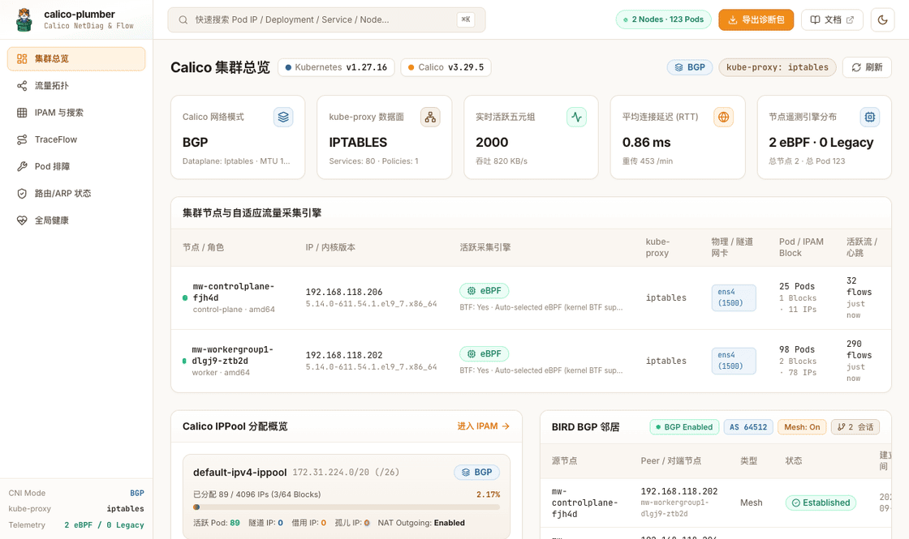
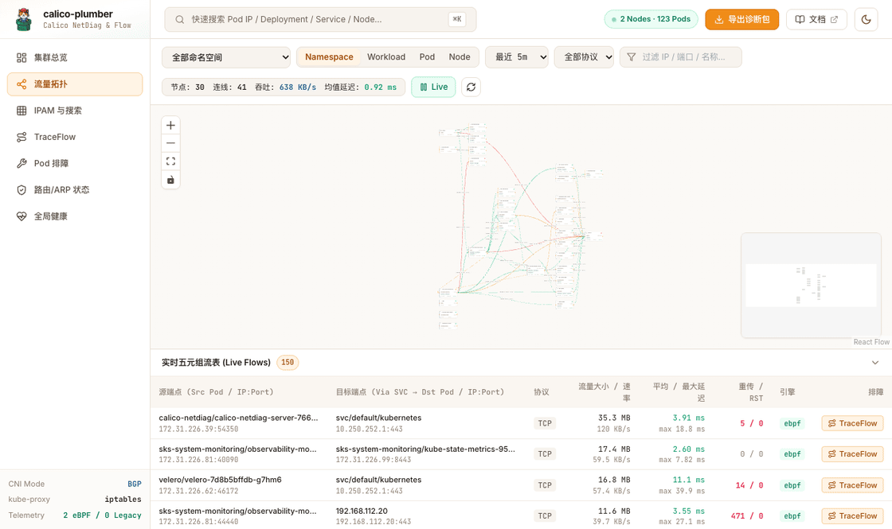
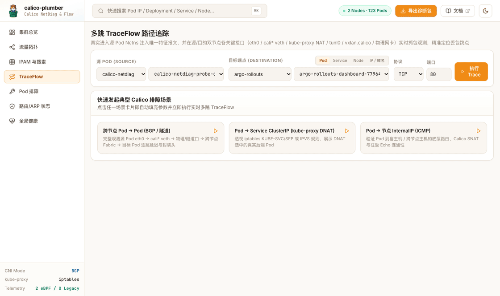
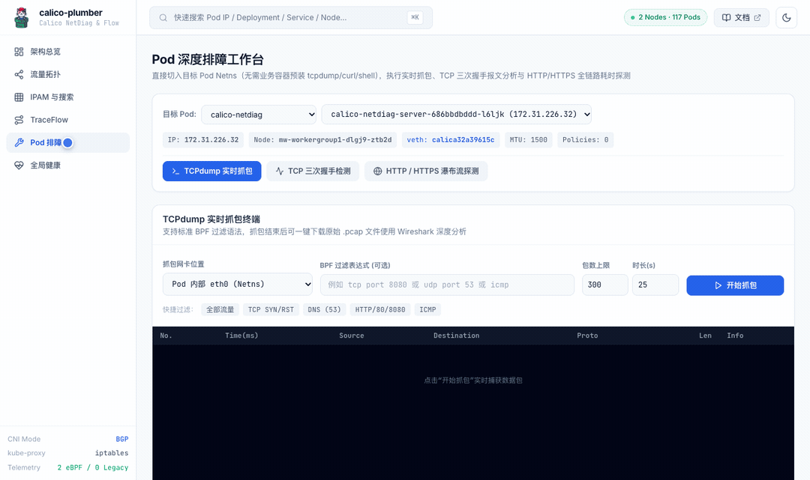
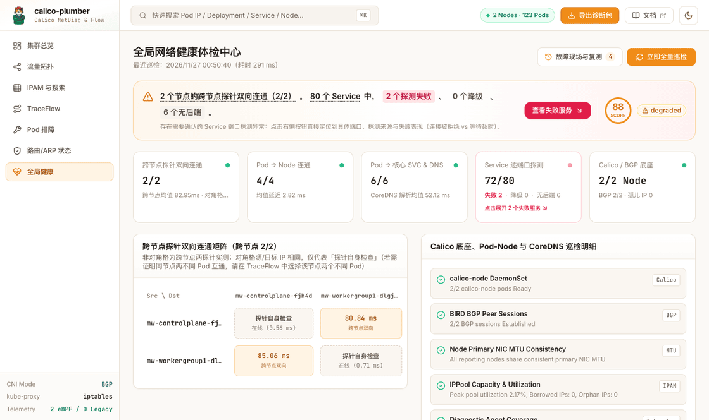

<p align="center">
  
</p>

<h1 align="center">calico-plumber</h1>

<p align="center">
  <strong>容器化 Kubernetes Calico 网络诊断与流量可视化平台</strong><br />
  面向生产集群的一站式 Calico 排障工具箱：BGP / IPIP / VXLAN 全模式感知 · 自适应 eBPF / Legacy 双引擎流量拓扑 · 多跳 TraceFlow · 零侵入 Pod 抓包与握手探测 · 全局网络体检
</p>

<p align="center">
  <a href="https://hub.docker.com/u/lammw12"></a>
  
  
  
  
  <a href="LICENSE"></a>
</p>

<p align="center">
  <a href="#一项目功能简介">项目简介</a> ·
  <a href="#二快速部署方式">部署方式</a> ·
  <a href="#三六大核心功能与演示">六大核心功能（含 GIF）</a> ·
  <a href="docs/chaos-network-lab.md">Chaos Mesh 故障注入排障实验</a> ·
  <a href="#四故障注入排障实战与内置文档">文档与性能评估</a>
</p>

---

## 一、项目功能简介

**calico-plumber** 是一款专为 Kubernetes **Calico** 网络打造的容器化 Web 诊断与可观测性平台，帮助运维与平台工程师把分散在 `calicoctl`、`birdcl`、`tcpdump`、`conntrack`、`iptables/ipvsadm` 中的排障工作整合到一个可视化控制台中：

- **全模式网络感知**：自动识别 Calico **BGP 直连**、**IPIP**（`Always` / `CrossSubnet`）、**VXLAN**（`Always` / `CrossSubnet`）及 **kube-proxy**（`iptables` / `IPVS` / `nftables` / Calico eBPF）模式，直连节点 `/var/run/calico/bird.ctl` 实时采集 BIRD BGP 邻居状态。
- **自适应双引擎流量遥测**：
  - **模式一 — `eBPF`**：在支持 BTF 的现代内核（Linux 5.8+ 或 RHEL / Rocky 8/9 等）上自动加载 CO-RE eBPF 探针，零侵入获取五元组流量、吞吐速率、内核 `srtt_us` 连接延迟及 TCP 重传 / RST 统计。
  - **模式二 — `Legacy`**：在不具备 BTF/eBPF 条件的老内核节点上自动平滑降级为 **Netlink Conntrack + Pod Netns `INET_DIAG` (`tcp_info`)** 混合采集，同一集群内异构内核节点无缝混部。
- **零侵入单 Pod 深度排障**：Node Agent 通过宿主机进入目标 Pod 的 Network Namespace，**无需业务容器预装 `tcpdump`、`curl`、`nc` 或 `sh`**（完美兼容 `distroless` / `scratch` 镜像），即可执行实时抓包（支持 `.pcap` 下载）、TCP 三次握手时序检测、HTTP/HTTPS 瀑布流探测与多跳 TraceFlow。
- **全维度 IPAM & 资产检索**：深度解析 `IPPool`、`IPAMBlock`、`BlockAffinity` CRD，提供节点级 IP 位图热力图（活跃 Pod / 隧道 IP / 跨节点借用 / 孤儿残留 / 空闲）与 `⌘K` 全局检索。
- **全局网络健康巡检**：内置轻量 Probe DaemonSet，一键执行 Pod-Pod N×N 跨节点延迟矩阵、Pod-Node、Pod-SVC & CoreDNS 及全集群 Service ClusterIP vs 后端 Pod 穿透体检。
- **内置 Hugo 技术文档**：Web 控制台右上角一键直达内置静态文档站（`/docs/`），涵盖实现原理、网络/性能影响评估与常见实战排障教程。

### 系统架构

```mermaid
flowchart TB
    User["浏览器 Web 控制台 / 内置 Hugo 文档 (/docs/)"]

    subgraph CP["控制面 Deployment (calico-netdiag-server)"]
        API["REST / WebSocket API + 嵌入式 React SPA & Hugo Docs"]
        Store["K8s & Calico CRD Store\n(IPPool / IPAMBlock / BGP / Pod / Service)"]
        FlowAgg["全局流量聚合与拓扑引擎"]
        Orch["多跳 TraceFlow 编排器 & 全局健康巡检器"]
    end

    subgraph Node["各集群节点 DaemonSet"]
        subgraph Agent["calico-netdiag-agent (hostNetwork / hostPID)"]
            Engine["自适应双引擎采集\neBPF (CO-RE) / Legacy (Conntrack + INET_DIAG)"]
            Netns["零侵入 Pod Netns 诊断器\nTraceFlow / TCPdump / TCP 握手 / HTTP 探测"]
            DP["Calico 数据面探测器\nBIRD Socket / Route / iptables / IPVS"]
        end
        Probe["calico-netdiag-probe\n(每节点 Pod 级连通性轻量探针)"]
    end

    User -->|HTTP / WebSocket| API
    API --> Store
    API --> FlowAgg
    API --> Orch
    Store -->|Read-Only RBAC| K8sAPI[("Kubernetes API Server")]
    Engine -->|定时上报五元组/吞吐/RTT| FlowAgg
    Orch <-->|HTTP / WS 协同抓包与探测| Netns
    Orch <-->|Pod-Pod / SVC 探测| Probe
    DP -->|节点 BGP/数据面状态| API
```



---

## 二、快速部署方式

### 前置要求

- Kubernetes `v1.22+` 集群（使用 Calico CNI，支持 Operator 或 Manifests 安装方式）
- 镜像架构：`linux/amd64`（公开镜像已托管于 Docker Hub `docker.io/lammw12`）
- 内核兼容性：
  - 支持 `/sys/kernel/btf/vmlinux` 的节点将自动运行 **`eBPF`** 模式；
  - 无 BTF 的旧内核节点将自动运行 **`Legacy`** 模式，无需额外手工配置。

### 方式 1：单文件一键部署（推荐）

直接使用包含命名空间、只读 RBAC、Server、Agent DaemonSet 与 Probe DaemonSet 的整合清单（拉取 Docker Hub 公开镜像）：

```bash
kubectl apply -f https://raw.githubusercontent.com/sdnmw/calico-plumber/main/deploy/k8s-dockerhub.yaml
```

检查 Pod 就绪状态：

```bash
kubectl -n calico-netdiag get pods -o wide
```

期望输出所有节点上的 `calico-netdiag-agent`、`calico-netdiag-probe` 以及 `calico-netdiag-server` 均为 `Running (1/1)`。

### 方式 2：克隆仓库分模块部署

```bash
git clone https://github.com/sdnmw/calico-plumber.git
cd calico-plumber
kubectl apply -f deploy/k8s/
```

### 访问 Web 控制台与内置文档

1. **NodePort 访问（默认已开启 `31880`）**：
   - Web 控制台：`http://<任意集群节点IP>:31880`
   - 内置技术文档：`http://<任意集群节点IP>:31880/docs/`

2. **本地 `kubectl port-forward` 访问**：
   ```bash
   kubectl -n calico-netdiag port-forward svc/calico-netdiag-server 8080:8080
   # 浏览器访问 http://localhost:8080
   ```

3. **通过 Ingress 绑定自定义域名**：
   可参考模板 [deploy/k8s/05-ingress-optional.yaml.example](deploy/k8s/05-ingress-optional.yaml.example)，修改 `ingressClassName` 与 `host` 后应用即可。
   > **提示**：实时 TCPdump 使用 WebSocket（`/api/v1/diag/tcpdump/ws`），若使用 NGINX / Envoy 等 Ingress Controller，请确保开启 WebSocket 透传并适当调大读写超时（如 `600s`）。

### 切换流量采集引擎模式

在 `deploy/k8s/03-agent-daemonset.yaml`（或 `deploy/k8s-dockerhub.yaml`）中修改 Agent 容器的 `TELEMETRY_MODE` 环境变量即可按需切换：

| 取值 | 行为说明 |
| :--- | :--- |
| `auto`（默认） | 自动探测宿主机 BTF 与 eBPF 条件：满足则启用 **`eBPF`**，否则自动降级为 **`Legacy`** |
| `ebpf` | 优先启用 **`eBPF`** 模式，加载失败时自动回退 **`Legacy`** |
| `conntrack` | 强制所有节点使用 **`Legacy`**（Netlink Conntrack + Pod Netns `INET_DIAG`）模式 |

```bash
# 示例：临时切换全集群 Agent 为 Legacy 模式验证
kubectl -n calico-netdiag set env ds/calico-netdiag-agent TELEMETRY_MODE=conntrack
# 恢复自适应模式
kubectl -n calico-netdiag set env ds/calico-netdiag-agent TELEMETRY_MODE=auto
```

### 从源码自行构建镜像

项目所有组件均采用多阶段 Dockerfile（`Dockerfile.server` 内置完成 React UI 构建、Hugo 文档生成与 Go 静态嵌入编译）：

```bash
# 运行 Go 单元测试
make test

# 构建并推送 3 个组件镜像至自定义仓库（默认 REGISTRY=docker.io/lammw12）
make build-push REGISTRY=<your-registry>/<project> TAG=v0.1.0
```

> 若在受限网络环境构建，可通过 `--build-arg GOPROXY=https://goproxy.cn,direct` 及 `GO_IMAGE` / `NODE_IMAGE` / `ALPINE_IMAGE` 参数替换为本地镜像加速器。

### 卸载清理

```bash
kubectl delete -f https://raw.githubusercontent.com/sdnmw/calico-plumber/main/deploy/k8s-dockerhub.yaml --ignore-not-found
```

---

## 三、六大核心功能与演示

下面通过 6 段在线集群实录 GIF，快速了解 **calico-plumber** 的六大核心模块。

### 1. 架构总览（Cluster Fabric Overview）

进入控制台即可一屏掌控整个集群的 Calico 网络画像：
- 自动识别 **Calico 封装模式**（BGP / IPIP / VXLAN / CrossSubnet）与 **`kube-proxy` 数据面模式**（iptables / IPVS / nftables）；
- 展示 **实时活跃五元组数**、**平均连接延迟（RTT）** 与 **各节点遥测引擎分布**（`eBPF` vs `Legacy`）；
- 实时列出每个节点的 **BIRD BGP Peer 会话状态**、内核版本、网卡拓扑与 IPPool 使用率，支持明暗主题切换与右上角一键打开内置技术文档。



---

### 2. 全局流量拓扑（Live Traffic Topology）

将集群内实时活跃网络流渲染为可交互的有向拓扑图，快速发现异常流量、跨节点热点与高延迟链路：
- 支持按 **Namespace / Workload / Pod / Node** 四个维度实时切换聚合粒度，并按关键词筛选 IP、端口或服务名；
- 连线实时标注吞吐速率与延迟，点击任意流量边即可展开 **五元组明细抽屉**，查看精确的源/目的 IP:Port、协议、实时吞吐、平均 / P95 内核延迟、TCP 重传与 RST 统计；
- 支持从任意异常连接直接一键跳转发起 **TraceFlow** 或 **TCPdump**。



---

### 3. IPAM 全景与全局检索（IPAM Heatmap & Omni-Search）

彻底告别手工翻查 Calico `IPAMBlock` 与 `BlockAffinity` 的繁琐过程：
- **节点级 IPAM 位图热力图**：直观区分每个 IP 槽位的状态——**活跃 Pod**（绿）、**隧道 IP**（紫）、**跨节点借用**（黄）、**孤儿残留**（红）与 **空闲**（灰），快速排查 IP 耗尽与残留泄漏；
- **Pod 深度检查抽屉**：点击热力图中的任意 IP 格即可侧滑查看该 Pod 所属节点、`cali*` veth 网卡、容器内路由表、生效的 NetworkPolicy 以及一键诊断入口；
- **`⌘K` 全维度全局搜索**：在任意页面按下 `⌘K` / `Ctrl+K`，按 **Pod IP / ClusterIP / Pod / Deployment / Service / Node / 标签** 毫秒级定位排障目标。


---

### 4. 多跳路径追踪（Live TraceFlow）

针对“同一集群内不通 / 偶发超时 / Service 转发异常”等疑难场景，提供真实报文级别的端到端多跳观测：
- 支持 **同节点 Pod → Pod**、**跨节点 Pod → Pod**、**Pod → Service (DNAT)**、**Pod → Node** 及 **Pod → 外部 IP** 五类目标，支持 TCP / UDP / ICMP 协议；
- 由源节点 Agent 切入源 Pod Netns 注入带唯一特征的真实探测报文，同时在源/目的双节点的 **`eth0` → `cali*` veth → 路由/NAT → `tunl0`/`vxlan.calico` → 物理网卡** 全路径同步捕获观测；
- 按泳道可视化呈现 **正向路径与回程路径**，自动解包展示 IPIP / VXLAN 外层隧道头、每跳时间戳与精确丢包点。



---

### 5. 单 Pod 零侵入排障工作台（Pod Troubleshoot Suite）

无需向业务容器注入 debug 边车或预装任何网络工具，选定任意 Pod 即可执行三大深度诊断：
- **TCPdump 实时抓包**：支持选择 Pod `eth0` 或宿主机 `cali*` / `tunl0` / `vxlan.calico` / 物理网卡，支持标准 BPF 过滤语法、WebSocket 实时流式输出、点击单帧查看 **Hex / ASCII 原始载荷** 以及抓包结束后一键下载 **`.pcap` 文件** 供 Wireshark 分析；
- **TCP 三次握手检测**：在 Pod Netns 内精确观测 `SYN → SYN-ACK → ACK`（或 `RST` / 超时）完整时序与微秒级 RTT，清晰定位建连拒绝、防火墙丢弃或中间链路抖动；
- **HTTP / HTTPS 瀑布流探测**：输出 **DNS 解析 → TCP 建连 → TLS 握手 → TTFB 首字节 → 内容传输** 逐阶段耗时瀑布图、响应状态码与自签名证书跳过选项。



---

### 6. 全局网络健康检查（Global Health Audit）

用于变更前基准验证、变更后回归巡检及日常网络 SLA 监控：
- **全节点 Pod-Pod N×N 延迟矩阵**：基于每节点轻量 Probe Pod 实测同节点与跨节点连通性及延迟，点击矩阵中任意异常单元格可直接带参跳转发起 **TraceFlow**；
- **基础设施连通性检查**：自动验证 Pod-Node、Pod-SVC（Kubernetes API / CoreDNS）以及 Calico BGP 会话、MTU 一致性与 IPAM 水位；
- **全集群 Service 后端穿透审计**：逐一对比每个 Service 的 **ClusterIP 访问连通性** 与 **直连各后端 Pod Endpoint 的 TCP 连通性**，一眼区分是 `kube-proxy` 规则问题还是后端业务 Pod 自身故障。



---

## 四、故障注入排障实战与内置文档

### Chaos Mesh 容器网络故障注入实战手册

仓库在 [`docs/`](docs/chaos-network-lab.md) 目录提供了一套完整的 **Chaos Mesh + Kubernetes/Calico 故障注入与排障实验手册**（附可一键部署的靶场与故障 YAML 清单及 **Chaos Mesh Web UI + calico-plumber Web UI 双视角实机截图**）：

- 📖 完整实验指南：[**docs/chaos-network-lab.md**](docs/chaos-network-lab.md)
- 🧪 实验覆盖 6 大经典故障：**跨节点网络高延迟与抖动**（`NetworkChaos: delay`）、**35% 高丢包与 TCP 重传风暴**（`NetworkChaos: loss`）、**跨节点双向网络分区**（`NetworkChaos: partition`）、**NetworkPolicy 误配精准端口阻断**、**Service `targetPort` 错配秒回 `RST`**，以及 **外部旧内核 `tcp_tw_recycle=1` + Calico SNAT 引发的“Pod 能通、同节点 Node 不通（PAWS 丢包）”**。

### 内置技术文档与性能说明

点击 Web 控制台右上角 **「文档」** 按钮即可访问内置的 Hugo 技术文档站（`/docs/`），包含三篇深度文档：

1. **核心实现原理**（[docs-hugo/content/principles.md](docs-hugo/content/principles.md)）：详述 Calico 模式识别、BIRD Unix Socket 通信、`eBPF` CO-RE vs `Legacy` 采集管线、多节点 TraceFlow 协同与 Netns 零侵入抓包原理。
2. **性能与网络影响评估**（[docs-hugo/content/performance.md](docs-hugo/content/performance.md)）：对 CPU、内存、带宽与业务转发延迟的量化评估。
3. **常用使用教程与实战**（[docs-hugo/content/tutorials.md](docs-hugo/content/tutorials.md)）：常见排障场景端到端 SOP。

### 性能与安全边界摘要

| 维度 | `eBPF` 模式（默认现代内核） | `Legacy` 模式（旧内核自动降级） |
| :--- | :--- | :--- |
| **业务转发路径侵入** | **零旁路拦截**（仅只读 kprobe 统计，不修改/丢弃数据包） | **零旁路拦截**（仅定时读取内核 Conntrack 表与 `INET_DIAG`） |
| **单节点典型 CPU 开销** | 约 `10m – 40m`（硬限制 `500m`） | 约 `20m – 80m`（硬限制 `500m`） |
| **单节点典型内存占用** | 约 `35Mi – 80Mi`（硬限制 `256Mi`） | 约 `40Mi – 95Mi`（硬限制 `256Mi`） |
| **K8s RBAC 权限** | Server 仅需 **只读**（`get`/`list`/`watch`）权限，不修改任何 K8s / Calico 资源 | 同左 |

---

## 五、项目目录结构

```text
calico-plumber/
├── cmd/
│   ├── server/          # 控制面主程序（聚合 API、TraceFlow 编排、嵌入 Web UI 与 Hugo Docs）
│   ├── agent/           # 节点 DaemonSet Agent（eBPF/Legacy 遥测、Netns 排障、BIRD/Dataplane 探测）
│   └── probe/           # 轻量级每节点连通性探针 DaemonSet
├── pkg/
│   ├── model/           # 共享数据模型（Cluster / IPAM / Flow / TraceFlow / Diag / Health）
│   ├── k8s/             # K8s & Calico CRD Informer、IPAM 位图分类器、Omni-Search 索引
│   ├── agent/           # Netns 切入、BIRD/Route/IPVS 探测、eBPF CO-RE & Legacy 采集引擎、排障执行器
│   └── server/          # 流量聚合环、Agent 客户端、TraceFlow 拼接器、全局健康体检器、REST/WS API
├── web/                 # React 19 + TypeScript + Vite + Tailwind + React Flow 前端工程
├── docs-hugo/           # Hugo 静态技术文档源码（嵌入至 /docs/）
├── docs/
│   ├── assets/          # README 6 大功能演示 GIF 动图
│   ├── chaos-network-lab.md  # Chaos Mesh + Calico 六大经典网络故障注入与排障实战手册
│   └── lab/             # 故障注入实验 YAML 清单与 Chaos Mesh / calico-plumber 双界面截图
├── deploy/
│   ├── docker/          # 多阶段 Dockerfile（Server / Agent / Probe）
│   ├── k8s/             # 分模块 Kubernetes 部署清单与 Ingress 模板
│   └── k8s-dockerhub.yaml  # 单文件一键部署清单
├── Makefile
└── LICENSE              # Apache License 2.0
```

---

## License

本项目采用 [Apache License 2.0](LICENSE) 协议开源。
