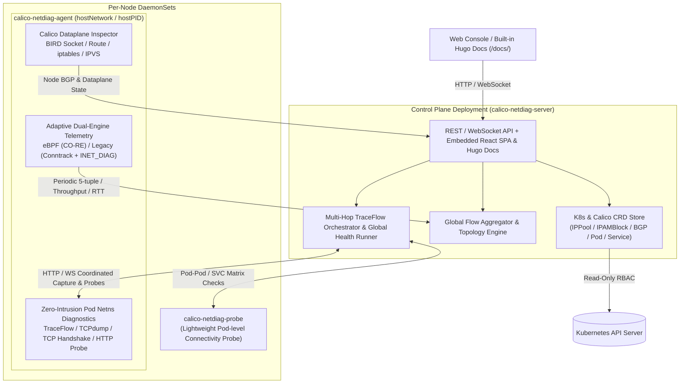
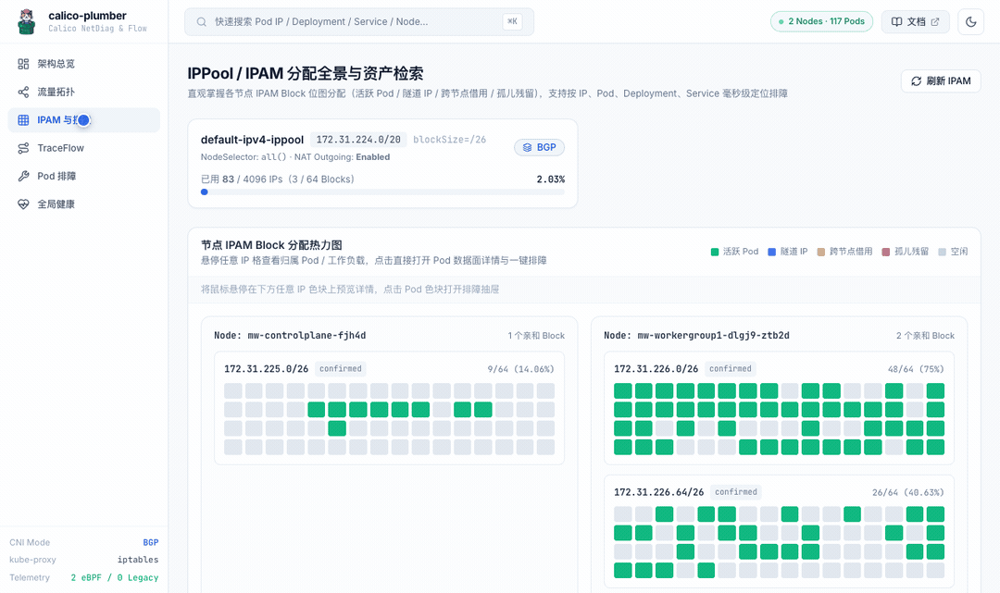

<p align="center">
  
</p>

<h1 align="center">calico-plumber</h1>

<p align="center">
  <strong>Containerized Kubernetes Calico Network Diagnostics &amp; Live Flow Observability Platform</strong><br />
  An all-in-one Web troubleshooting toolbox for production Calico clusters: BGP / IPIP / VXLAN aware · Adaptive eBPF / Legacy dual-engine traffic topology · Multi-hop TraceFlow · Zero-intrusion Pod TCPdump &amp; handshake probes · Global network health audits
</p>

<p align="center">
  <strong>English</strong> · <a href="README_ZH.md">简体中文</a>
</p>

<p align="center">
  <a href="https://hub.docker.com/u/lammw12"></a>
  
  
  
  
  <a href="LICENSE"></a>
</p>

<p align="center">
  <a href="#1-overview--capabilities">Overview</a> ·
  <a href="#2-quick-deployment">Deployment</a> ·
  <a href="#3-seven-core-modules--live-demos">7 Core Modules (GIF Demos)</a> ·
  <a href="docs/chaos-network-lab.md">Chaos Mesh &amp; Fault Lab</a> ·
  <a href="#4-fault-injection-lab-built-in-docs--performance">Docs &amp; Performance</a>
</p>

---

## 1. Overview & Capabilities

**calico-plumber** is a containerized web-based diagnostics and flow observability platform purpose-built for Kubernetes **Calico** networks. It consolidates scattered CLI workflows (`calicoctl`, `birdcl`, `tcpdump`, `conntrack`, `iptables`, `ipvsadm`) into a single interactive console:

- **Full-Mode Calico & `kube-proxy` Awareness**: Automatically detects Calico **BGP Direct**, **IPIP** (`Always` / `CrossSubnet`), and **VXLAN** (`Always` / `CrossSubnet`) encapsulation along with `kube-proxy` dataplane modes (`iptables` / `IPVS` / `nftables` / Calico eBPF), and queries `/var/run/calico/bird.ctl` directly for live BIRD BGP peer status.
- **Adaptive Dual-Engine Traffic Telemetry**:
  - **Mode 1 — `eBPF`**: Automatically attaches CO-RE eBPF probes on BTF-capable kernels (Linux 5.8+, RHEL/Rocky 8/9, etc.) for zero-intrusion 5-tuple tracking, throughput, kernel `srtt_us` latency, and TCP retransmits / RST metrics.
  - **Mode 2 — `Legacy`**: Seamlessly falls back to **Netlink Conntrack + Pod Netns `INET_DIAG` (`tcp_info`)** on older kernels without BTF/eBPF, supporting heterogeneous kernel clusters out of the box.
- **Zero-Intrusion Per-Pod Troubleshooting & Layered TraceFlow**: Node Agents enter target Pod Network Namespaces directly from the host — **no `tcpdump`, `curl`, `nc`, or shell required inside application containers** (works seamlessly on `distroless` / `scratch` images) — enabling live packet capture (`.pcap` export), TCP 3-way handshake timing, HTTP/HTTPS waterfall probing, and multi-hop TraceFlow rendered as a realistic Node / Physical NIC / OS Kernel & User Space / vSwitch-Tunnel / Container stack with hop-by-hop packet animation.
- **Network Health & Consistency Audits**: Inspects Calico network mode & MTU encapsulation overhead, runs interactive Pod-Netns Path MTU / DF blackhole probes, verifies BIRD BGP neighbors and Expected vs. Actual kernel route consistency (missing routes, ghost `/32` routes, asymmetric paths), inspects L2 MAC / Gateway ARP / Calico Proxy ARP tables, and correlates NAT issues with expandable Conntrack & Sysctl kernel evidence.
- **One-Click Offline Diagnostic Bundle (`.zip`)**: Export a self-contained `.zip` archive from the global topbar, Audit page, or any TraceFlow result — bundling an offline `report.html` and structured JSON snapshots (`01..07-*.json`) for ticket handoff and postmortems.
- **IPAM Heatmap & Omni-Search**: Parses Calico `IPPool`, `IPAMBlock`, and `BlockAffinity` CRDs to render per-node IP allocation bitmaps (Active Pod / Tunnel IP / Cross-Node Borrowed / Orphan / Free) plus instant `⌘K` search across IPs, Pods, Deployments, Services, Nodes, and labels.
- **Global Network Health Audits**: Ships with a lightweight per-node Probe DaemonSet to run one-click N×N Pod-to-Pod latency matrices, Pod-Node / Pod-SVC & CoreDNS checks, and cluster-wide Service ClusterIP vs. direct backend Pod audits.
- **Built-in Hugo Documentation**: Click **Docs (`文档`)** in the top-right corner of the Web UI (`/docs/`) for architecture deep dives, performance/network impact analysis, and practical troubleshooting runbooks.

### Architecture



---

## 2. Quick Deployment

### Prerequisites

- Kubernetes `v1.22+` cluster running **Calico CNI** (Tigera Operator or Manifest installation)
- Architecture: `linux/amd64` (public prebuilt images hosted on Docker Hub under `docker.io/lammw12`)
- Kernel compatibility:
  - Nodes with `/sys/kernel/btf/vmlinux` automatically activate **`eBPF`** mode;
  - Older kernels without BTF automatically fall back to **`Legacy`** mode with zero manual configuration.

### Option 1: Single-File One-Click Deploy (Recommended)

Deploy the all-in-one manifest (Namespace, read-only RBAC, Server Deployment, Agent DaemonSet, and Probe DaemonSet using public Docker Hub images):

```bash
kubectl apply -f https://raw.githubusercontent.com/sdnmw/calico-plumber/main/deploy/k8s-dockerhub.yaml
```

Verify all components are `Running (1/1)`:

```bash
kubectl -n calico-netdiag get pods -o wide
```

### Option 2: Clone & Apply Modular Manifests

```bash
git clone https://github.com/sdnmw/calico-plumber.git
cd calico-plumber
kubectl apply -f deploy/k8s/
```

### Accessing the Web UI & Built-in Docs

1. **Via NodePort (enabled on `31880` by default)**:
   - Web Console: `http://<any-node-ip>:31880`
   - Built-in Documentation: `http://<any-node-ip>:31880/docs/`

2. **Via `kubectl port-forward`**:
   ```bash
   kubectl -n calico-netdiag port-forward svc/calico-netdiag-server 8080:8080
   # Open http://localhost:8080 in your browser
   ```

3. **Via Ingress**:
   See [deploy/k8s/05-ingress-optional.yaml.example](deploy/k8s/05-ingress-optional.yaml.example) and update `ingressClassName` and `host` for your environment.
   > **Note**: Live TCPdump streams over WebSocket (`/api/v1/diag/tcpdump/ws`). Ensure your Ingress controller permits WebSocket upgrades and configures an appropriate read/send timeout (e.g., `600s`).

### Switching Telemetry Modes

Configure the `TELEMETRY_MODE` environment variable on `calico-netdiag-agent` (`deploy/k8s/03-agent-daemonset.yaml` or `deploy/k8s-dockerhub.yaml`):

| Value | Behavior |
| :--- | :--- |
| `auto` (default) | Detects host BTF/eBPF capability automatically: enables **`eBPF`** when supported, otherwise falls back to **`Legacy`** |
| `ebpf` | Prefers **`eBPF`** mode and falls back to **`Legacy`** if loading fails |
| `conntrack` | Forces **`Legacy`** mode (Netlink Conntrack + Pod Netns `INET_DIAG`) on all nodes |

```bash
# Example: temporarily switch all nodes to Legacy mode
kubectl -n calico-netdiag set env ds/calico-netdiag-agent TELEMETRY_MODE=conntrack

# Restore adaptive auto-selection
kubectl -n calico-netdiag set env ds/calico-netdiag-agent TELEMETRY_MODE=auto
```

### Building from Source

All three components ship with self-contained multi-stage Dockerfiles (`Dockerfile.server` compiles the React UI, builds the Hugo docs site, and embeds both into the Go server binary):

```bash
# Run Go unit tests with race detection
make test

# Build and push all 3 images to your own registry (defaults to docker.io/lammw12)
make build-push REGISTRY=<your-registry>/<project> TAG=v0.1.0
```

> In restricted or mirror-accelerated environments, override base images and Go proxy via `--build-arg GOPROXY=...`, `GO_IMAGE`, `NODE_IMAGE`, or `ALPINE_IMAGE`.

### Uninstall

```bash
kubectl delete -f https://raw.githubusercontent.com/sdnmw/calico-plumber/main/deploy/k8s-dockerhub.yaml --ignore-not-found
```

---

## 3. Seven Core Modules & Live Demos

Below are 7 live-recorded interactive GIFs captured directly from a running Kubernetes + Calico cluster showcasing every core capability of **calico-plumber**.

### 1. Cluster Overview

Get a complete cluster networking snapshot at a glance:
- Displays crisp Kubernetes & Calico version badges, auto-detects **Calico encapsulation mode** (BGP / IPIP / VXLAN / CrossSubnet) and **`kube-proxy` mode** (iptables / IPVS / nftables);
- Shows **live active 5-tuples**, **average connection RTT**, and **per-node telemetry engine distribution** (`eBPF` vs. `Legacy`);
- Lists live **BIRD BGP peer sessions** with status chips (`BGP Enabled`, `AS`, `Node-to-Node Mesh`), node kernel versions, NIC topology, and IPPool utilization, plus light/dark theme toggle, one-click Diagnostic Bundle export, and built-in Hugo docs.


---

### 2. Live Traffic Topology

Visualize active cluster flows as an interactive directed graph to pinpoint anomalous connections, cross-node hotspots, and latency spikes:
- Switch aggregation granularity in real time across **Namespace / Workload / Pod / Node**, and filter by IP, port, protocol, or workload name;
- Hover over any truncated endpoint name in the **Live 5-Tuple Flows** table to reveal the full Pod/Service name and `IP:Port` immediately;
- Edges display live throughput and latency; click any edge to open the **5-Tuple Flow Detail Drawer** and launch **TraceFlow** or **TCPdump** in one click.


---

### 3. IPAM Heatmap & Omni-Search

Eliminate manual `calicoctl ipam show` and `IPAMBlock` YAML inspection:
- **IPPool & Per-Node Block Occupancy**: Displays cluster `IPPool` capacity side-by-side with a **Per-Node IPAM Block Occupancy** card showing block counts, utilization bars, and per-CIDR usage chips;
- **Per-Node IPAM Bitmap Heatmap**: Color-codes every IP slot — **Active Pod** (green), **Tunnel IP** (purple), **Cross-Node Borrowed** (amber), **Orphan** (red), and **Free** (gray) — click any allocated cell to open the **Pod Inspector Drawer** (`cali*` veth, Pod routes, NetworkPolicies);
- **`⌘K` / `Ctrl+K` Global Omni-Search**: Search instantaneously by **Pod IP, ClusterIP, Pod, Deployment, Service, Node, or label** from any screen.



---

### 4. Multi-Hop Live TraceFlow

End-to-end packet-level path tracing for hard-to-debug connectivity failures, silent drops, Service DNAT, and external SNAT:
- Ships with 3 **One-Click Quick Scenarios** (Cross-Node Pod → Pod, Pod → Service DNAT, Pod → Node ICMP) over TCP / UDP / ICMP;
- Renders a realistic vertical layered host stack (**Node Baseplate → Physical NIC → OS Kernel & User Space → vSwitch/Tunnel → Container `eth0`**) with **step-by-step hop-by-hop packet flow playback**;
- Decodes outer IPIP/VXLAN headers, handles Calico `MASQUERADE --random-fully` SNAT and `hostNetwork` Services accurately, and supports **Export Diagnostic Bundle** right from the verdict banner.


---

### 5. Zero-Intrusion Pod Troubleshoot Suite

Run deep L3–L7 diagnostics on any Pod without sidecars, `kubectl debug`, or preinstalled container tools:
- **Live TCPdump**: Capture on Pod `eth0` or host `cali*` / `tunl0` / `vxlan.calico` / primary physical NIC with standard BPF filters, live WebSocket streaming, per-frame **Hex / ASCII payload inspection**, and one-click **`.pcap` download** for Wireshark;
- **TCP 3-Way Handshake Probe**: Captures exact `SYN → SYN-ACK → ACK` (or `RST` / `SYN_TIMEOUT`) timing ladders with microsecond RTTs to distinguish silent policy drops from closed ports (`Connection Refused`);
- **HTTP / HTTPS Waterfall Probe**: Breaks down **DNS → TCP Connect → TLS Handshake → TTFB → Content Transfer** latency stages with status code, response headers/preview, and self-signed TLS skip support.


---

### 6. Route / ARP Audit & One-Click Diagnostic Bundle

Layer-by-layer Calico network auditing with concise, actionable findings and offline incident packaging:
- **Network Mode & MTU Encapsulation Chain + Path MTU DF Probe**: Visualizes encapsulation overhead (BGP `0B` / IPIP `20B` / VXLAN `50B`) and NIC → Tunnel → Pod veth MTU alignment, paired with an interactive Pod-Netns **DF Blackhole Binary-Search Probe**;
- **Concise Diagnostic Findings**: Surfaces clear **Result, Root Cause Prediction, and Verification Method** with expandable **Conntrack / Sysctl Kernel Evidence** on demand;
- **Calico BGP Neighbors & Expected vs. Actual Route Diff**: Compares expected Calico IPAM/Pod routes against live Linux kernel routing tables to catch missing blocks, ghost Pod `/32` routes, asymmetric paths, and BGP flapping;
- **L2 MAC & ARP Neighbor Table**: Live physical NIC MAC, default gateway ARP, Calico `cali*` Proxy ARP status, and IPv4 neighbor cache highlighting `FAILED` entries;
- **One-Click Diagnostic Bundle (`.zip`)**: Exports a self-contained offline `report.html` plus structured JSON evidence (`01..07-*.json`).


---

### 7. Global Network Health Audit

Ideal for pre-change baselines, post-upgrade verification, and continuous cluster network checks:
- **N×N Pod-to-Pod Latency Matrix**: Measures intra-node and cross-node Pod reachability and RTT across every node; click any cell to jump straight into **TraceFlow** with prefilled endpoints;
- **Infrastructure Checks**: Continuously verifies Pod-Node, Pod-SVC (Kubernetes API / CoreDNS), Calico DaemonSet, BIRD BGP peers, NIC MTU consistency, and IPAM utilization;
- **Cluster-Wide Service Backend Penetration Audit (Click-to-Jump)**: Clicking the **Service Backend Health** KPI card (or its broken/degraded/no-endpoint counts) smoothly scrolls to the audit table, filters to abnormal services, and auto-expands the first failing Service to reveal backend `TCP FAIL` details.


---

## 4. Fault Injection Lab, Built-in Docs & Performance

### Chaos Mesh & Calico Fault Injection Troubleshooting Lab

The [`docs/`](docs/chaos-network-lab.md) directory includes a hands-on, reproducible **container network fault injection & troubleshooting lab** featuring ready-to-apply manifests and **real browser screenshots of both Chaos Mesh Web UI and calico-plumber Web UI** *(currently written in Chinese with universal YAML manifests & annotated screenshots)*:

- 📖 Full Lab Guide: [**docs/chaos-network-lab.md**](docs/chaos-network-lab.md)
- 🧪 Covers **6 classic production network failure scenarios**:
  1. **Cross-Node Latency & Jitter** (Chaos Mesh `NetworkChaos: delay 250ms ± 50ms`) → Topology RTT alert + HTTP Waterfall breakdown
  2. **High Packet Loss & TCP Retransmission Storm** (Chaos Mesh `NetworkChaos: loss 35%`) → Topology retransmit alert + Live TCPdump capturing out-of-order SACK & retransmitted frames
  3. **Bidirectional Network Partition** (Chaos Mesh `NetworkChaos: partition`) → TraceFlow source-side drop pinpointing + TCP `SYN_TIMEOUT`
  4. **Misconfigured NetworkPolicy Port Drop** → Pod Inspector Drawer exposing matched policy + TraceFlow highlighting `Calico Ingress Policy` & exact `cali-tw-*` iptables chain
  5. **Service `targetPort` Mismatch (`Connection Refused`)** → Global Health Service audit flagging `broken` + `<1ms` TCP `RST_REFUSED`
  6. **External Legacy Kernel `net.ipv4.tcp_tw_recycle=1` + Calico SNAT ("Pod Succeeds, Same-Node Host Fails")** → Topology side-by-side green Pod vs. red Node + `0.31ms ESTABLISHED` vs. `SYN_TIMEOUT` handshake contrast + host `ens4` TCPdump + remote `TSval` rollback & `PAWSPassive` verification

### Built-in Hugo Technical Documentation

Click **Docs (`文档`)** in the top-right bar of the console (`/docs/`) to browse three embedded deep-dive guides:

1. **Architecture & Internals** ([docs-hugo/content/principles.md](docs-hugo/content/principles.md)): Calico mode detection, BIRD Unix socket querying, `eBPF` CO-RE vs. `Legacy` telemetry pipelines, multi-node TraceFlow coordination, and host-side netns execution.
2. **Performance & Network Impact** ([docs-hugo/content/performance.md](docs-hugo/content/performance.md)): Quantified CPU, memory, bandwidth, and data-path latency bounds.
3. **Practical Runbooks** ([docs-hugo/content/tutorials.md](docs-hugo/content/tutorials.md)): Step-by-step production troubleshooting SOPs.

### Performance & Security Footprint Summary

| Aspect | `eBPF` Mode (Modern Kernels, Default) | `Legacy` Mode (Older Kernels, Auto-Fallback) |
| :--- | :--- | :--- |
| **Data-Path Impact** | **Zero inline interception** (read-only kprobe telemetry; never modifies or drops packets) | **Zero inline interception** (periodic Netlink Conntrack & `INET_DIAG` reads) |
| **Typical Per-Node CPU** | `~10m – 40m` (hard limit `500m`) | `~20m – 80m` (hard limit `500m`) |
| **Typical Per-Node RAM** | `~35Mi – 80Mi` (hard limit `256Mi`) | `~40Mi – 95Mi` (hard limit `256Mi`) |
| **Kubernetes RBAC** | Server uses strictly **read-only** (`get` / `list` / `watch`) permissions; never mutates cluster resources | Same |

---

## 5. Project Structure

```text
calico-plumber/
├── cmd/
│   ├── server/          # Control-plane binary (API, TraceFlow orchestrator, embedded Web UI & Hugo Docs)
│   ├── agent/           # Node DaemonSet Agent (eBPF/Legacy telemetry, Netns diagnostics, BIRD/Dataplane inspector)
│   └── probe/           # Lightweight per-node Pod connectivity probe DaemonSet
├── pkg/
│   ├── model/           # Shared domain models (Cluster / IPAM / Flow / TraceFlow / Diag / Health)
│   ├── k8s/             # K8s & Calico CRD store, IPAM bitmap classifier, Omni-Search index
│   ├── agent/           # Netns executor, BIRD/Route/IPVS inspector, eBPF CO-RE & Legacy engines, diagnostic runners
│   └── server/          # Flow ring store, Agent client, TraceFlow stitcher, global health runner, REST/WS router
├── web/                 # React 19 + TypeScript + Vite + Tailwind CSS + React Flow frontend
├── docs-hugo/           # Hugo documentation source (embedded at /docs/)
├── docs/
│   ├── assets/          # 6 interactive feature demo GIFs for README
│   ├── chaos-network-lab.md  # 6-scenario Chaos Mesh & Calico fault-injection troubleshooting lab
│   └── lab/             # Reproducible lab manifests & Chaos Mesh / calico-plumber UI screenshots
├── deploy/
│   ├── docker/          # Multi-stage Dockerfiles (Server / Agent / Probe)
│   ├── k8s/             # Modular Kubernetes manifests & Ingress template
│   └── k8s-dockerhub.yaml  # Single-file one-click deployment manifest
├── Makefile
├── README.md            # English README (default)
├── README_ZH.md         # Simplified Chinese README
└── LICENSE              # Apache License 2.0
```

---

## License

Licensed under the [Apache License 2.0](LICENSE).
