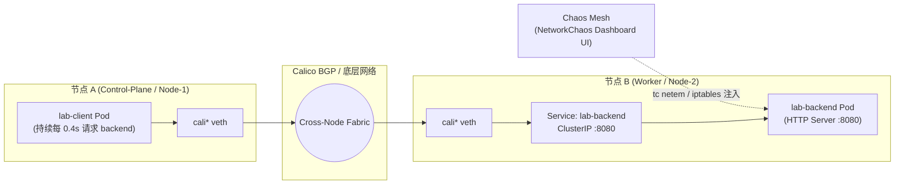
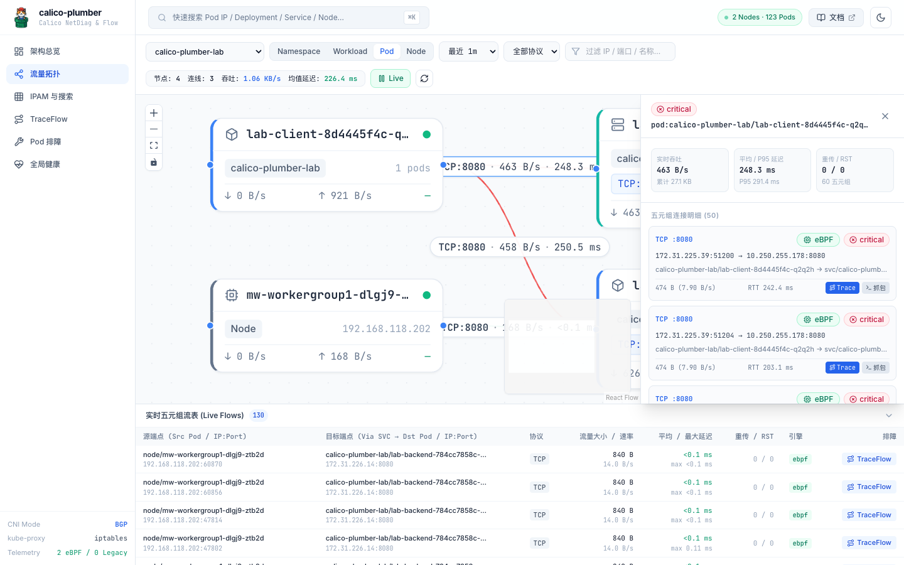
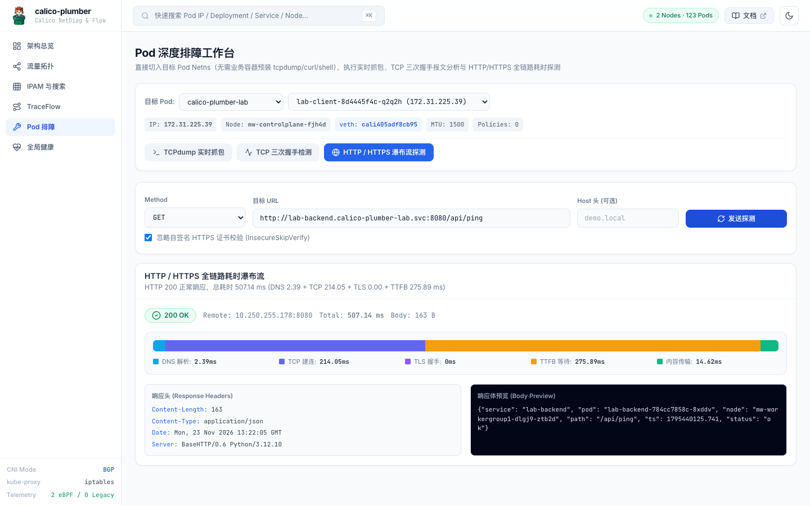
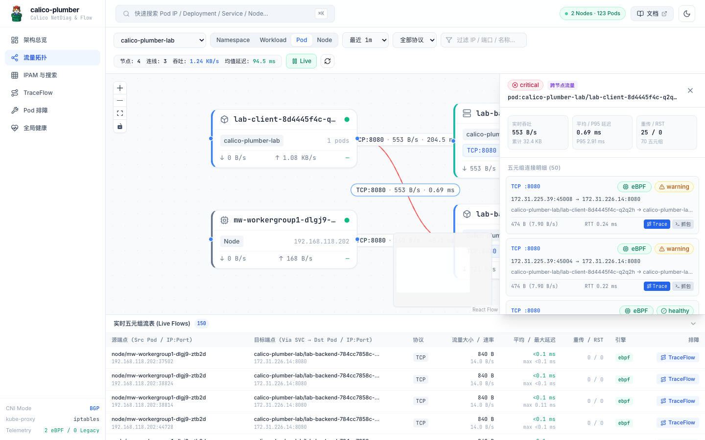
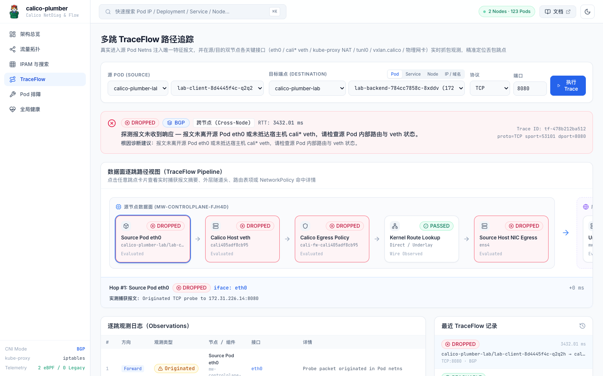
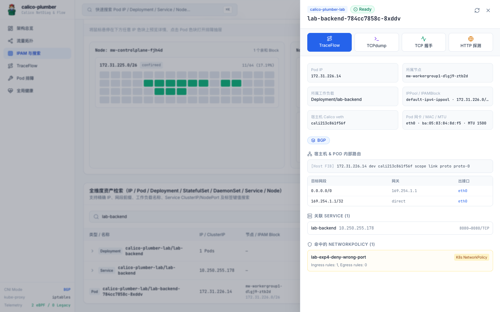
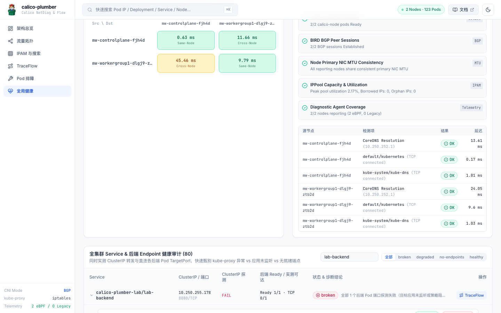

# 容器网络故障注入与 calico-plumber 排障实战手册

本手册设计了一套可复现的 **Kubernetes + Calico 跨节点容器网络故障注入与诊断实验室**，结合 **Chaos Mesh**（`NetworkChaos`）与真实生产常见的 **NetworkPolicy / Service 误配场景**，演示如何通过 **calico-plumber** 在分钟级完成从“现象发现 → 路径定界 → 报文取证 → 根因定位 → 恢复验证”的全流程排障。

> **实验覆盖的五大经典网络故障模式**：
> 1. **实验 1 — 跨节点网络高延迟与抖动**（Chaos Mesh `NetworkChaos: delay`）→ `流量拓扑 + HTTP 瀑布流`
> 2. **实验 2 — 高丢包率与 TCP 重传风暴**（Chaos Mesh `NetworkChaos: loss`）→ `流量拓扑重传标红 + Pod 实时 TCPdump 抓包`
> 3. **实验 3 — 跨节点双向网络分区**（Chaos Mesh `NetworkChaos: partition`）→ `多跳 TraceFlow + TCP 三次握手 SYN_TIMEOUT`
> 4. **实验 4 — NetworkPolicy 误配导致精准端口阻断**（`Ingress Policy Drop`）→ `IPAM Pod 检查抽屉 + TraceFlow 策略链定位`
> 5. **实验 5 — Service `targetPort` 错配（应用端口未监听）**（`Connection Refused`）→ `全局健康 Service 穿透审计 + TCP 三次握手秒回 RST`

---

## 一、实验环境与靶场架构

### 1.1 拓扑说明

为了还原真实生产中的跨节点 Calico 转发路径，我们在隔离命名空间 `calico-plumber-lab` 中部署一组双层 HTTP 微服务，并通过 `podAntiAffinity` 将两端调度在不同节点上：



### 1.2 前置部署

1. **部署 Chaos Mesh（含 Web Dashboard UI，适配 `containerd` 运行时）**：
   ```bash
   helm repo add chaos-mesh https://charts.chaos-mesh.org
   helm repo update

   helm upgrade --install chaos-mesh chaos-mesh/chaos-mesh \
     -n chaos-mesh --create-namespace \
     --set chaosDaemon.runtime=containerd \
     --set chaosDaemon.socketPath=/run/containerd/containerd.sock \
     --set dashboard.securityMode=false \
     --set dashboard.service.type=NodePort
   ```
   > 若测试集群控制面节点存在 `NoSchedule` 污点且需要对其上的 Pod 注入故障，请额外追加 `--set "chaosDaemon.tolerations[0].operator=Exists"`。

2. **部署跨节点实验靶场（[lab/00-target-app.yaml](lab/00-target-app.yaml)）**：
   ```bash
   kubectl apply -f docs/lab/00-target-app.yaml
   kubectl -n calico-plumber-lab get pods,svc -o wide
   ```

### 1.3 正常基线观测（Baseline）

故障注入前，在 **calico-plumber** 中打开 **「流量拓扑」**，筛选命名空间 `calico-plumber-lab`、粒度切换为 **`Pod`**、时间窗选择 **`最近 1m`**，点击跨节点连线即可看到健康基线：
- **跨节点 RTT 均值**：`0.66 ms`（P95 `3.52 ms`）
- **TCP 重传 / RST**：`0 / 0`
- **健康状态**：绿色 `healthy`（eBPF CO-RE 实时采集）


---

## 二、五大经典故障注入与排障实录

### 实验 1：跨节点网络高延迟与抖动（Chaos Mesh `delay: 250ms ± 50ms`）

#### 故障背景与注入

模拟跨机柜/跨可用区链路拥塞或底层网卡排队导致的接口响应变慢，但业务日志无报错、Pod 探针全部 `Ready`。

```bash
kubectl apply -f docs/lab/01-chaos-delay.yaml
```

> **工程细节**：`01-chaos-delay.yaml` 选择 `selector: app=lab-backend` 且 `direction: to`、`target: app=lab-client`。原因在于 `lab-client` 通过 Service ClusterIP 访问 `lab-backend`，经过宿主机 `kube-proxy` DNAT 后到达 `lab-backend` 时源 IP 仍保留为 `lab-client` 的真实 Pod IP；因此该配置同时覆盖 **Service 与直连 Pod 流量**，且不会误伤 `kubelet` 的节点本地探针（`lab-backend` 保持 `1/1 Ready`）。

在 **Chaos Mesh Dashboard Web UI** 中确认实验进入 `Running` 状态，事件时间轴显示已成功注入目标 Pod，`Definition` 面板清晰展示 `latency: 250ms` / `jitter: 50ms`：


#### 使用 calico-plumber 诊断排障

1. **第一步 — 流量拓扑秒级定位慢链路**：
   切回 **calico-plumber「流量拓扑」**（`calico-plumber-lab` / `最近 1m`），`lab-client → lab-backend` 跨节点连线立刻标红告警（`critical`）：
   - 实时延迟从基线 `0.66 ms` 暴涨至 **`248.3 ms`（P95 `291.4 ms`）**，重传为 `0`；
   - 同画布下方节点本地探针 `mw-workergroup1 → lab-backend` 延迟仍为 `<0.1 ms`，**一秒排除节点内业务进程卡死**，锁定为跨节点网络延迟。

   

2. **第二步 — Pod 排障 HTTP 瀑布流拆分耗时阶段**：
   点击连线进入 **「Pod 排障 → HTTP / HTTPS 瀑布流探测」**，以 `lab-client` 视角发起 `GET http://lab-backend.calico-plumber-lab.svc:8080/api/ping`：
   - **DNS 解析**：`2.39 ms`（排除 CoreDNS 慢查询）
   - **TCP 建连**：`214.05 ms`（1 次往返即叠加 ~250ms 延迟）
   - **TTFB 等待**：`275.89 ms`（HTTP 请求/响应再叠加 1 次 ~250ms 延迟）
   - **总耗时**：`507.14 ms`（`200 OK`），精准证实根因为传输层往返延迟（RTT）翻倍。

   

清理实验 1：
```bash
kubectl delete -f docs/lab/01-chaos-delay.yaml
```

---

### 实验 2：高丢包率与 TCP 重传风暴（Chaos Mesh `loss: 35%`）

#### 故障背景与注入

模拟光模块劣化、交换机端口 CRC 错包或宿主机软中断溢出引起的随机丢包：业务表现“大部分请求几毫秒完成，偶发毛刺飙升到 1 秒以上甚至请求超时”。

```bash
kubectl apply -f docs/lab/02-chaos-loss.yaml
```

在 **Chaos Mesh Dashboard Web UI** 确认 `lab-exp2-packet-loss` 处于 `Running` 状态（`action: loss`、`loss: 35%`、`correlation: 25%`）：


#### 使用 calico-plumber 诊断排障

1. **第一步 — 流量拓扑捕获 TCP 重传尖峰**：
   在 **calico-plumber「流量拓扑」**中，`lab-client → lab-backend` 跨节点边立刻变为 `critical` 告警；展开右侧五元组明细可见：
   - **平均 RTT 依然极低（`0.69 ms`）**（与实验 1 的“高延迟零重传”形成鲜明对比！）；
   - 但 **TCP 重传数在 1 分钟内飙升至 `25`**，多条 eBPF 五元组连接被标为 `warning`，直接指向丢包而非链路拥塞延迟。

   

2. **第二步 — 零侵入 Pod TCPdump 抓包取证**：
   点击右侧明细中的 **「抓包」** 进入 **「Pod 排障 → TCPdump 实时抓包」**（无需 `lab-client` 容器预装 `tcpdump`），设置 BPF 过滤 `tcp port 8080` 并点击开始：
   - 实时流清晰记录了乱序与重传全过程：
     - **Frame #10**：`8080 → 46344 [ACK,PSH,FIN] Seq=2253218109`（后续分段先到，前序 HTTP Header 分段被丢弃）
     - **Frame #11**：`46344 → 8080 [ACK] Ack=2253217963`（客户端发送重复 ACK 请求补发缺失序列号）
     - **Frame #12**：`8080 → 46344 [ACK,PSH] Seq=2253217963 Len=146`（服务端重传丢失的 HTTP Header 分段）
   - 停止抓包后可点击单帧查看 Hex / ASCII 载荷或一键导出 `.pcap` 交由 Wireshark 留档。

   

清理实验 2：
```bash
kubectl delete -f docs/lab/02-chaos-loss.yaml
```

---

### 实验 3：跨节点双向网络分区（Chaos Mesh `partition: both`）

#### 故障背景与注入

模拟脑裂、底层防火墙规则误拦截或主机侧规则阻断导致的两个微服务之间完全断联，客户端全部报 `i/o timeout`。

```bash
kubectl apply -f docs/lab/03-chaos-partition.yaml
```

在 **Chaos Mesh Dashboard Web UI** 确认 `lab-exp3-network-partition` 已在 `lab-client` 与 `lab-backend` 上生效（`action: partition`、`direction: both`）：


#### 使用 calico-plumber 诊断排障

1. **第一步 — 多跳 TraceFlow 精准定界丢包位置**：
   打开 **「TraceFlow」**，选择源 Pod `calico-plumber-lab/lab-client` → 目标 Pod `calico-plumber-lab/lab-backend`（`TCP:8080`），点击 **「执行 Trace」**：
   - 结果立刻返回 **`DROPPED · BGP · 跨节点 (Cross-Node)`**；
   - 逐跳泳道清晰指出：**`Kernel Route Lookup`（宿主机 BGP 路由）为 `PASSED`**，但报文在 **`Source Pod eth0` 即已被拦截未发出至宿主机 `cali*` veth** —— 这正是 Chaos Mesh 在 Pod Netns 内插入 `CHAOS-OUTPUT` iptables `DROP` 链的真实内核行为！

   

2. **第二步 — TCP 三次握手确认“静默丢包（`SYN_TIMEOUT`）”**：
   进入 **「Pod 排障 → TCP 三次握手检测」**，探测 `lab-backend.calico-plumber-lab.svc:8080`：
   - **DNS 解析正常**（`2.54 ms` 解析出 ClusterIP `10.250.255.178`）；
   - 随后发出的 `SYN` 在 `+2.54ms`、`+1066.47ms` 连续重传，始终未收到 `SYN-ACK` 或 `RST`，`3000ms` 后诊断结论明确输出 **`SYN_TIMEOUT`** —— 铁证表明中间存在静默丢包（防火墙 / 网络策略 / 网络分区），而非对端端口未监听。

   

清理实验 3：
```bash
kubectl delete -f docs/lab/03-chaos-partition.yaml
```

---

### 实验 4：NetworkPolicy 误配导致的精准端口阻断（Calico Ingress Policy Drop）

#### 故障背景与注入

这是 Kubernetes + Calico 生产环境中**最高发**的故障之一：Pod 全是 `Running`、Service Endpoint 完整、BGP 路由正常，但安全基线或发布人员在配置 `NetworkPolicy` 时将允许端口误写成 `8443`（实际服务监听 `8080`），导致 `lab-client → lab-backend:8080` 被目标节点 Calico Felix 规则静默丢弃。

```bash
kubectl apply -f docs/lab/04-networkpolicy-drop.yaml
```

#### 使用 calico-plumber 诊断排障

1. **第一步 — IPAM & Pod 深度检查抽屉直查生效策略**：
   打开 **「IPAM 与搜索」**，搜索 `lab-backend` 并点击 Pod 名称滑出右侧 **Pod 检查抽屉**，直接暴露 `lab-backend` 的 `cali*` veth、IPAM Block、内部路由表以及当前命中的 **`NetworkPolicy: lab-exp4-deny-wrong-port`**！

   

2. **第二步 — 多跳 TraceFlow 精确标红目标节点 `Calico Ingress Policy` 与底层链名**：
   执行 `lab-client → lab-backend:8080` 实时 **TraceFlow**，可以看到与实验 3 截然不同的跨节点逐跳路径：
   - 源节点 `eth0 → cali* veth → Egress Policy → Route → ens4` 全部 **`OBSERVED / PASSED`**；
   - 底层 BGP 转发正常，**目标节点物理网卡 `Dest Host NIC Ingress (ens4)` 已实测收到报文（`+1.14ms`）**；
   - 报文在 **`Hop #8: Calico Ingress Policy (cali-tw-cali*)`** 精准标红 **`DROPPED`**，底部详情栏直接打印出命中的策略名称与底层 iptables 链：
     `Matched 1 policy(s): lab-exp4-deny-wrong-port | Ingress(cali-tw-cali213c861f56f): DROP`！

   

清理实验 4：
```bash
kubectl delete -f docs/lab/04-networkpolicy-drop.yaml
```

---

### 实验 5：Service `targetPort` 错配（应用端口未监听 → 秒回 `RST`）

#### 故障背景与注入

模拟上线变更误将 Service `targetPort` 从 `8080` 改为未监听的 `9999`（或业务进程崩溃未监听端口），客户端瞬间报错 `Connection refused`。

```bash
kubectl apply -f docs/lab/05-service-port-mismatch.yaml
```

#### 使用 calico-plumber 诊断排障

1. **第一步 — 全局健康体检中心一键揪出异常 Service 与后端端口**：
   打开 **「全局健康」** 点击 **「立即全量巡检」**，在底部 **全集群 Service & 后端 Endpoint 健康审计** 表格中搜索 `lab-backend` 并展开明细：
   - `calico-plumber-lab/lab-backend` 被精准标红为 **`broken`**；
   - **`ClusterIP 探测: FAIL`**，展开后的后端探测明细直接指出 **`172.31.226.14:9999 → TCP FAIL`**，清晰区分“kube-proxy 规则故障”与“后端目标端口本身不可达”。

   

2. **第二步 — TCP 三次握手毫秒级捕获 `RST_REFUSED`**：
   在 **「Pod 排障 → TCP 三次握手检测」** 中从 `lab-client` 探测 `lab-backend.calico-plumber-lab.svc:8080`：
   - 仅耗时 **`0.77 ms`** 即收到对端内核返回的 **`[RST] Connection refused`**（`Δ 0.48ms`）；
   - 报告直接给出明确结论：**`网络路由与策略已通，但目标端口未监听或应用拒绝连接`**，彻底避免在防火墙/Calico 路由上浪费排障时间。

   

---

## 三、排障决策速查表（基于实验总结）

通过上述 5 组实验，日常遇到 Kubernetes / Calico 网络故障时可按以下决策矩阵快速定位：

| 故障现象 | 首选 calico-plumber 模块 | 关键判据 | 典型根因 |
| :--- | :--- | :--- | :--- |
| **接口变慢、无报错** | `流量拓扑` + `HTTP 瀑布流` | 拓扑 RTT 飙升但重传=0；瀑布流中 TCP 建连与 TTFB 同步拉长、DNS 正常 | 跨节点链路延迟、底层网络拥塞、`tc netem`/QoS 限速 |
| **偶发 1s+ 毛刺或超时** | `流量拓扑` + `TCPdump 抓包` | 拓扑平均 RTT 正常但 **Retransmits 飙升标红**；抓包见乱序 DupACK / 同 Seq 重传 | 物理链路丢包、网卡 RingBuffer/软中断丢包、MTU 不一致 |
| **完全超时（3s+ 无响应）** | `TraceFlow` + `TCP 三次握手` | 握手报告 **`SYN_TIMEOUT`**；TraceFlow 精确标红是在源 Pod、底层网络还是目标 `Calico Ingress Policy` 丢弃 | NetworkPolicy 误配、安全组/防火墙拦截、节点网络分区、BGP 路由缺失 |
| **毫秒级 `Connection Refused`** | `全局健康` + `TCP 三次握手` | 握手报告 `<1ms` **`RST_REFUSED`**；全局健康 Service 穿透审计标红 `broken` 与具体 `PodIP:TargetPort` | Service `targetPort` 错配、容器进程未监听目标端口或绑定了 `127.0.0.1` |

---

## 四、恢复与清理实验环境

恢复 Service `targetPort: 8080`（可验证 `lab-client` 立即恢复 `[OK] 200 ~3ms`）：
```bash
kubectl apply -f docs/lab/00-target-app.yaml
```

如需彻底卸载实验靶场与 Chaos Mesh：
```bash
kubectl delete -f docs/lab/00-target-app.yaml --ignore-not-found
helm uninstall chaos-mesh -n chaos-mesh
kubectl delete ns chaos-mesh --ignore-not-found
```
